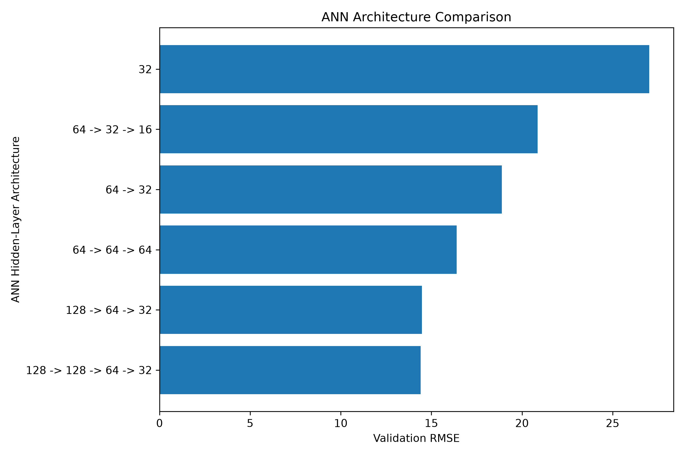
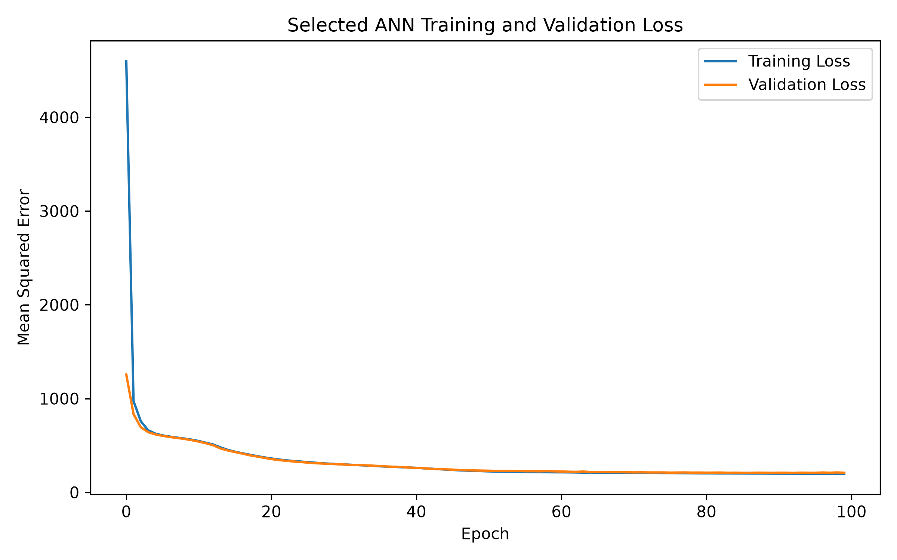
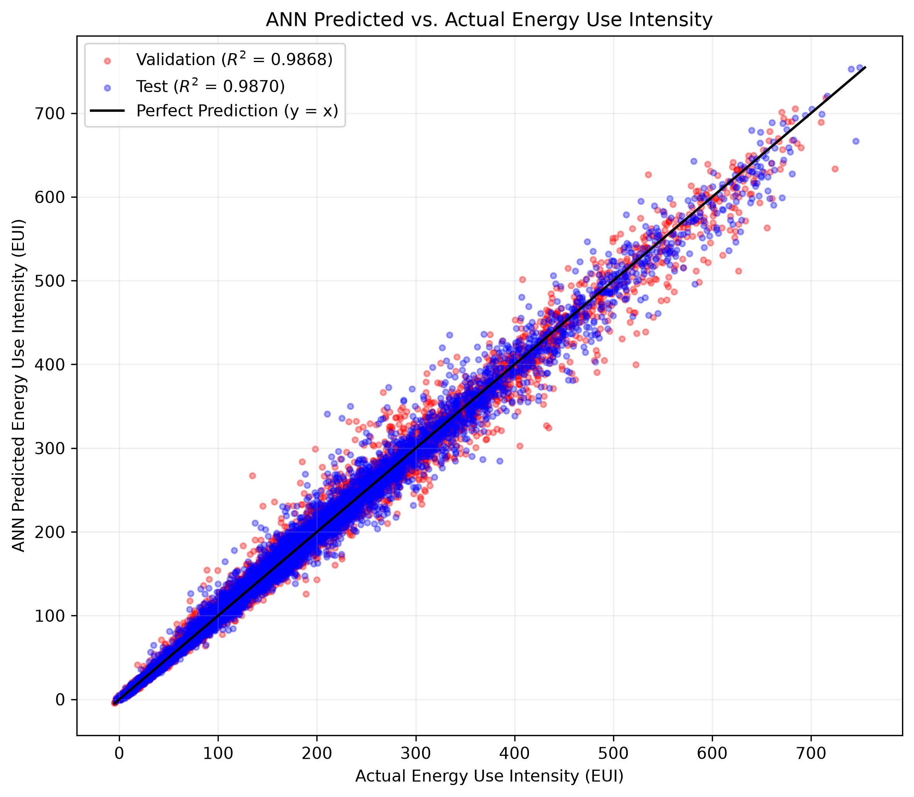
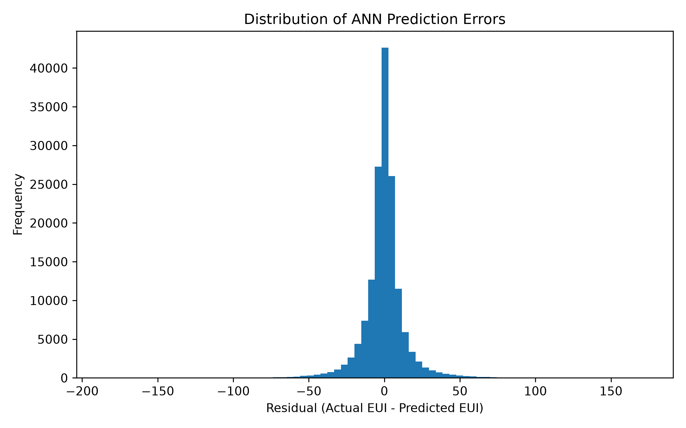
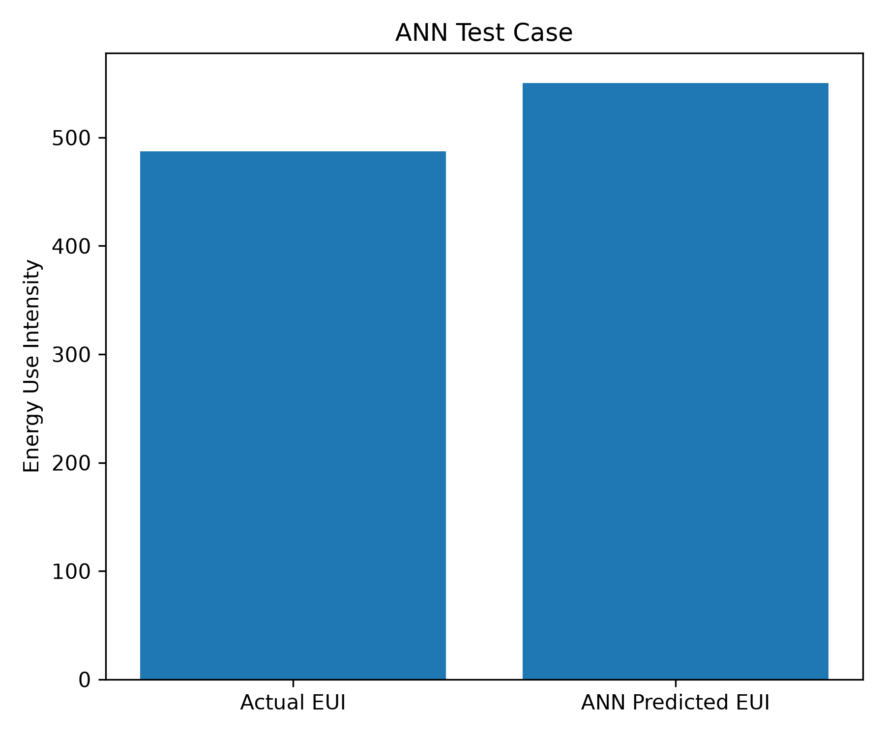

# AE555 ANN Building Energy Prediction

Artificial neural network (ANN) model for predicting residential building **Energy Use Intensity (EUI)** from building-envelope, HVAC, operational, geometric, and environmental characteristics.

This repository contains the Python implementation developed for the **AE 555 – Data Acquisition and Analytics in Built Environment** final project at Drexel University.

## Project Overview

The objective of this project is to develop and evaluate an ANN surrogate model for predicting residential building Energy Use Intensity:

\[
\mathrm{EUI}\;[\mathrm{kWh/(m^2\cdot year)}]
\]

The workflow includes:

- dataset characterization and descriptive statistics;
- Pearson correlation analysis;
- predictor selection;
- numerical standardization and categorical one-hot encoding;
- training, validation, and independent test partitioning;
- comparison of six ANN configurations;
- validation-based model selection;
- independent test-set evaluation;
- parity and residual analysis; and
- demonstration using an individual unseen test case.

The ANN is intended as a data-driven surrogate for relationships represented by the underlying EnergyPlus simulation dataset. It should not be interpreted as a replacement for physics-based simulation outside the parameter space represented by the source data.

---

## Dataset

This project uses **Version 5 of the Urban Building Energy Stock Datasets** published through Mendeley Data.

The dataset represents a synthetic residential building stock generated through physics-based parametric simulation using:

- **jEPlus** for parametric case generation;
- **EnergyPlus** for building-energy simulation; and
- **DesignBuilder** construction templates.

The dataset contains four residential building archetypes:

- Bungalow
- Detached
- Semi-detached
- Terraced

For the dataset used in this project:

| Property | Value |
|---|---:|
| Observations | 1,048,562 |
| Original variables | 31 |
| ANN predictors retained | 19 |
| Encoded ANN inputs | 24 |
| Missing values | 0 |
| Duplicate records | 0 |
| Prediction target | Energy Use Intensity |

Calculated energy outcomes such as heating energy, electricity energy, photovoltaic output, and building energy rating were not used as ANN predictors to reduce the risk of target leakage.

### Dataset Source

**Ali, U., Bano, S., & O'Donnell, J. (2024). Urban Building Energy Stock Datasets (Version 5). Mendeley Data.**

DOI: **10.17632/m6vv9k9gcd.5**

Dataset:  
https://data.mendeley.com/datasets/m6vv9k9gcd/5

The dataset is distributed under the **Creative Commons Attribution 4.0 International (CC BY 4.0)** license.

> The dataset itself is not included in this repository because of its size. Download `urban_building_stock_datasets_17042024.csv` from the Mendeley Data repository and place it in the project directory before running the analysis.

---

## Input Variables

The ANN uses 19 original predictor variables.

### Building and Geometry

- Building Type
- Building Orientation
- Window-to-Wall Ratio
- Total Building Area

### Building Envelope

- Floor Insulation U-Value
- Door Insulation U-Value
- Roof Insulation U-Value
- Window Insulation U-Value
- Wall Insulation U-Value

### HVAC and Ventilation

- HVAC Efficiency
- Heating Setpoint Temperature
- Heating Setback Temperature
- Air Change Rate

### Operation and Internal Loads

- Domestic Hot Water Usage
- Lighting Density
- Occupancy Level
- Equipment Density

### External and Energy-System Variables

- Weather File
- Renewable Energy Usage

---

## Data Preprocessing

Numerical predictors are standardized using:

\[
z=\frac{x-\mu}{\sigma}
\]

where the mean and standard deviation are estimated from the training subset.

Three categorical variables are represented using one-hot encoding:

- Weather File
- Building Type
- Renewable Energy Usage

After preprocessing, the 19 original predictors are transformed into **24 numerical ANN inputs**.

---

## Data Partition

The complete dataset is divided into three subsets using a fixed random seed for reproducibility:

| Subset | Percentage | Observations |
|---|---:|---:|
| Training | 70% | 733,993 |
| Validation | 15% | 157,284 |
| Independent test | 15% | 157,285 |

The training subset is used to optimize ANN parameters.

The validation subset is used to compare candidate ANN configurations and select the model architecture.

The independent test subset is withheld from architecture selection and used for final performance evaluation.

---

## ANN Training

The ANN uses fully connected dense layers with **Rectified Linear Unit (ReLU)** activation in the hidden layers and a single linear output neuron for EUI prediction.

Training configuration:

| Setting | Value |
|---|---|
| Optimizer | Adam |
| Loss function | Mean Squared Error (MSE) |
| Batch size | 1024 |
| Maximum epochs | 100 |
| Early-stopping patience | 10 |
| Model-selection criterion | Validation RMSE |

---

## Architecture Comparison

Six candidate hidden-layer configurations were evaluated using the same preprocessing and training procedure.

| Hidden Layers | Parameters | Validation R² | Validation MAE | Validation RMSE |
|---|---:|---:|---:|---:|
| 32 | 833 | 0.9536 | 16.768 | 27.012 |
| 64–32 | 3,713 | 0.9773 | 11.432 | 18.889 |
| 64–32–16 | 4,225 | 0.9723 | 11.953 | 20.859 |
| 64–64–64 | 9,985 | 0.9829 | 9.898 | 16.392 |
| 128–64–32 | 13,569 | 0.9867 | 8.806 | 14.470 |
| **128–128–64–32** | **30,081** | **0.9868** | **8.698** | **14.406** |

The **128–128–64–32** configuration produced the minimum validation RMSE and was therefore selected using the predefined model-selection criterion.

The 128–64–32 configuration achieved a very similar validation RMSE with fewer parameters, showing that increased model complexity did not produce a large improvement in this case.

---

## Selected ANN Architecture

The selected network is:

```text
19 original predictors
        |
        v
Data preprocessing
        |
        v
24 encoded ANN inputs
        |
        v
Dense 128 + ReLU
        |
        v
Dense 128 + ReLU
        |
        v
Dense 64 + ReLU
        |
        v
Dense 32 + ReLU
        |
        v
Linear output
        |
        v
Predicted EUI
```

The selected model contains **30,081 trainable parameters**.

---

## Independent Test Performance

The selected ANN was evaluated on **157,285 independent test observations**.

| Metric | Result |
|---|---:|
| R² | **0.9870** |
| MAE | **8.6657** |
| RMSE | **14.3217** |
| MAPE | **5.91%** |

MAPE was evaluated only for observations satisfying:

\[
|\mathrm{EUI}|\geq1
\]

because percentage errors become unstable when the target approaches zero.

The test-set R² indicates that approximately 98.7% of the variation in EUI is represented by the ANN predictions. R² should not be interpreted as 98.7% prediction accuracy for every individual building.

---

## Residual Analysis

Residuals are defined as:

\[
e_i=y_i-\hat{y}_i
\]

where positive residuals indicate underprediction and negative residuals indicate overprediction.

| Statistic | Residual |
|---|---:|
| Mean | -0.085 |
| Standard deviation | 14.322 |
| Minimum | -185.818 |
| 25th percentile | -4.942 |
| Median | 0.092 |
| 75th percentile | 4.848 |
| Maximum | 173.180 |

The mean residual is close to zero, indicating little aggregate signed prediction bias. Most residuals are concentrated near zero, although a smaller number of observations exhibit substantially larger deviations.

---

## Example Independent Test Case

One observation from the independent test subset was used to demonstrate the complete prediction workflow.

Selected characteristics include:

| Variable | Value |
|---|---|
| Building Type | Detached |
| Weather File | Historical |
| Renewable Energy | No |
| Building Area | 130.81 |
| Floor U-Value | 0.19 |
| Wall U-Value | 1.03 |
| Roof U-Value | 1.14 |
| Window U-Value | 1.80 |
| Door U-Value | 1.50 |
| HVAC Efficiency | 0.60 |
| Air Change Rate | 2.35 |
| Window-to-Wall Ratio | 70 |
| Heating Setpoint | 23 |
| Heating Setback | 14 |
| Lighting Density | 1 |
| Equipment Density | 16 |
| Occupancy Level | 6 |
| Domestic Hot Water Usage | 3.50 |
| Building Orientation | 0 |

Prediction result:

| Quantity | Result |
|---|---:|
| Simulated EUI | 487.481 kWh/(m²·year) |
| ANN-predicted EUI | 550.422 kWh/(m²·year) |
| Absolute error | 62.942 kWh/(m²·year) |
| Percentage error | 12.91% |

The individual error is larger than the overall test MAPE, illustrating why model performance should be evaluated across the complete independent test subset rather than from a single favorable prediction.

---

## Results and Figures

The analysis generates figures and CSV files for evaluating the ANN.

### Architecture Comparison



The architecture comparison shows the validation performance of the six candidate networks and supports selection of the 128–128–64–32 configuration.

### Training and Validation Loss



Training and validation MSE decrease together during training without pronounced late-stage divergence.

### Predicted vs. Simulated EUI



The parity plot compares ANN predictions with simulated EUI for the validation and independent test subsets.

### Residual Distribution



The residual distribution is concentrated near zero, consistent with the small aggregate signed prediction bias.

### Independent Test Case



The test-case figure compares the EnergyPlus-simulated EUI with the ANN prediction for one observation withheld from model selection.

> If your result images are stored under a different directory name, update the image paths above accordingly.

---

## Repository Structure

A recommended repository structure is:

```text
AE555-ANN-Building-Energy-Prediction/
│
├── ann_energy_model.py
├── requirements.txt
├── README.md
│
├── urban_building_stock_datasets_17042024.csv   # downloaded separately
│
└── results/
    ├── 01_correlation_EUI.png
    ├── 02_architecture_comparison.png
    ├── 03_training_validation_loss.png
    ├── 04_actual_vs_predicted.png
    ├── 05_residual_distribution.png
    ├── 06_test_case.png
    ├── 07_validation_test_parity_plot.png
    ├── architecture_comparison.csv
    ├── correlation_with_EUI.csv
    ├── descriptive_statistics.csv
    ├── final_test_performance.csv
    ├── residual_statistics.csv
    ├── ANN_test_case.csv
    └── AE555_best_ANN.keras
```

The large source dataset should normally remain outside version control and be downloaded directly from Mendeley Data.

---

## Installation

Python 3 with the following packages is required:

```bash
pip install numpy pandas matplotlib scikit-learn tensorflow
```

Alternatively:

```bash
pip install -r requirements.txt
```

A suitable `requirements.txt` is:

```text
numpy
pandas
matplotlib
scikit-learn
tensorflow
```

---

## Running the Analysis

1. Clone or download this repository.
2. Download Version 5 of the Urban Building Energy Stock Dataset from Mendeley Data.
3. Place `urban_building_stock_datasets_17042024.csv` in the project directory.
4. Install the required Python packages.
5. Run:

```bash
python ann_energy_model.py
```

The script performs the preprocessing, statistical analysis, ANN architecture comparison, model selection, independent test evaluation, residual analysis, and test-case demonstration.

Generated outputs are saved to the `results/` directory.

---

## Reproducibility

The analysis uses a fixed random seed for dataset partitioning and related randomized operations.

The same 70/15/15 training-validation-test partitioning procedure is used throughout the model-development workflow.

Because neural-network training and numerical libraries can exhibit small platform-dependent floating-point differences, exact values may vary slightly across TensorFlow versions, hardware, and operating systems.

---

## Scope and Limitations

This project uses a **synthetic, physics-based building simulation dataset**, not measured data from more than one million physical buildings.

Accordingly:

- the ANN learns relationships represented by the simulated building stock;
- the reported accuracy applies to scenarios drawn from the represented simulation distribution;
- high predictive performance does not establish causal relationships between predictors and EUI;
- the ANN should not be assumed to provide equivalent accuracy for real buildings outside the training-data distribution; and
- the model is best interpreted as a data-driven surrogate for the underlying simulated parameter space.

---

## Dataset Citation

If using the dataset, cite the official Mendeley Data record:

**Ali, U., Bano, S., & O'Donnell, J. (2024). _Urban Building Energy Stock Datasets_ (Version 5). Mendeley Data. https://doi.org/10.17632/m6vv9k9gcd.5**

The Mendeley Data record also requests citation of the related research article:

**Ali, U., Bano, S., Shamsi, M. H., Sood, D., Hoare, C., Zuo, W., Hewitt, N., & O'Donnell, J. (2024). Urban building energy performance prediction and retrofit analysis using data-driven machine learning approach. _Energy and Buildings, 303_, 113768. https://doi.org/10.1016/j.enbuild.2023.113768**

A related dataset-description article is:

**Ali, U., Bano, S., Shamsi, M. H., Sood, D., Hoare, C., Zuo, W., Hewitt, N., & O'Donnell, J. (2024). Urban residential building stock synthetic datasets for building energy performance analysis. _Data in Brief, 53_, 110241. https://doi.org/10.1016/j.dib.2024.110241**

---

## Acknowledgment

The building-energy dataset used in this project was developed by its original authors and distributed through Mendeley Data. All dataset ownership and attribution remain with the original creators.
